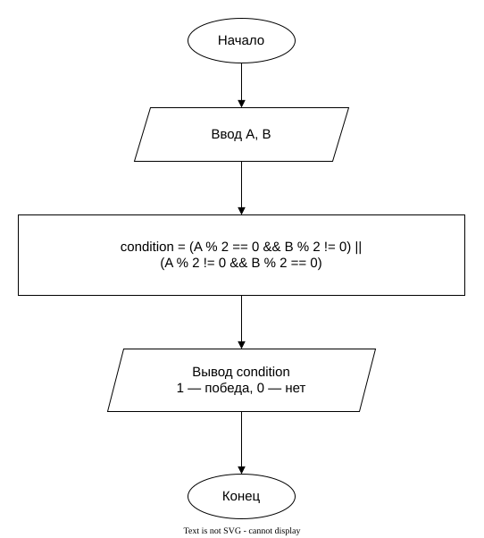

# Практическая работа 4. Особенности использование данных различного типа
# Индивидуальное задание

## Вариант 15

### Условие задачи

Написать программу на языке C, которая определяет, выполнено ли условие победы в раунде: номер кнопки одного игрока должен быть чётным, а другого — нечётным.

### Блок-схема алгоритма

[Открыть блок-схему в draw.io](https://app.diagrams.net/?lang=ru#Uhttps%3A%2F%2Fraw.githubusercontent.com%2FDregMenlion%2Flab-4%2Fmaster%2Fflowchart.drawio)

# Информация о разработчике

**Трофимовский Артём**  
Группа: **бОТИ-261**
